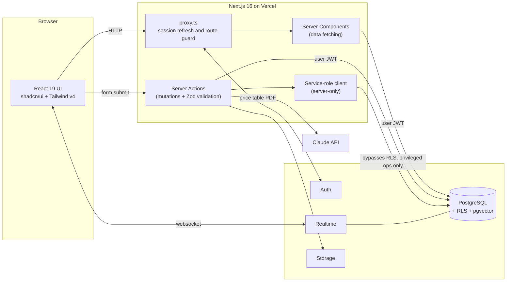
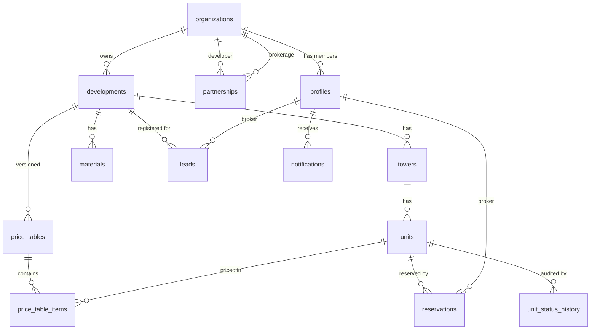

# Plataforma JF

> A B2B SaaS that connects real-estate developers (*construtoras*) and brokerages (*imobiliárias*) on the coast of Santa Catarina, Brazil. It offers a shared catalog of developments, versioned price tables extracted with AI, and a real-time sales availability map.


---

## Table of contents

- [The problem](#the-problem)
- [The solution](#the-solution)
- [Features](#features)
- [Tech stack](#tech-stack)
- [Architecture](#architecture)
- [Data model](#data-model)
- [Security model](#security-model)
- [Project structure](#project-structure)
- [Getting started](#getting-started)
- [Roadmap](#roadmap)
- [Conventions](#conventions)

---

## The problem

In the Brazilian new-build market, developers sell most of their units through partner brokerages. The information those brokers rely on is spread across many places:

- **Price tables are sent as PDFs and spreadsheets** over WhatsApp and e-mail. Every developer uses its own layout, a new version can come out every week, and brokers often quote prices from an outdated file.
- **Unit availability (the "sales map", or *espelho de vendas*) is out of date.** Brokers have to call the developer to find out whether a unit is still available, and two brokers can promise the same apartment to two different clients.
- **Marketing material** (books, floor plans, videos, virtual tours) sits in scattered drive folders with no versioning.
- **Lead ownership is unclear.** When two brokers bring in the same client, there is no reliable record of who registered the client first, and sharing client data with the developer raises LGPD (Brazil's data protection law) concerns.

## The solution

Plataforma JF gives developers and brokerages **one shared, access-controlled channel**:

| For developers | For brokerages and brokers |
|---|---|
| Publish developments, towers and units in one place | Browse every development they have a partnership with |
| Upload a price table PDF and let AI extract it into structured, reviewable data | Always see the current published price table, never a stale file |
| Update unit status once; every partner sees it instantly | Real-time sales map: available / reserved / sold / blocked |
| Approve or decline partnership requests and unit reservations | Reserve a unit and register leads with timestamped protection |
| Check lead registrations **without** seeing clients' personal data | Keep client data private to their own brokerage |

## Features

### Implemented (Phase A: foundation)

- **Authentication** with Supabase Auth: e-mail and password, magic link, and password recovery.
- **Session proxy** (`src/proxy.ts`, the Next.js 16 successor to `middleware.ts`) that protects authenticated routes and refreshes sessions.
- **Multi-tenant organizations**: developers and brokerages, each with its own team.
- **Role-based access**: `platform_admin`, `org_admin`, `manager` and `broker`.
- **Team invitations** by e-mail, with the role carried through the invite and the profile created automatically by a database trigger.
- **Broker profile** with a mandatory CRECI (Brazilian broker license number).
- **Platform admin console** for creating organizations.
- **Protection against privilege escalation**: users cannot change their own role through the API.
- **Automated tenant-isolation test** (`npm run test:rls`) that checks organization A cannot read organization B's data.
- **Design system** built on Tailwind v4 tokens and shadcn/ui, with a token preview page at `/design`.

### Modeled in the database, UI in progress

- Developments, towers and units, with an automatic audit trail of status changes.
- Versioned price tables (`draft → under review → published → archived`) with per-item AI confidence scores and an "edited by a human" flag.
- Marketing materials with versioning.
- Partnerships between developers and brokerages, with commission rates.
- Unit reservations with expiration, limited to one active reservation per unit.
- Leads with protection windows and phone-hash deduplication.
- In-app notifications.
- `pgvector` embeddings on developments for conversational search.

## Tech stack

| Layer | Technology |
|---|---|
| Framework | [Next.js 16](https://nextjs.org) (App Router, Server Components, Server Actions) |
| Language | TypeScript 5 |
| UI | React 19, [Tailwind CSS v4](https://tailwindcss.com), [shadcn/ui](https://ui.shadcn.com) on Radix UI, Lucide icons, Sonner toasts, `next-themes` |
| Forms and validation | React Hook Form and Zod 4 |
| Database | PostgreSQL on [Supabase](https://supabase.com), with Row Level Security and the `pgvector` extension |
| Auth | Supabase Auth through `@supabase/ssr` (cookie-based sessions) |
| Realtime | Supabase Realtime (Postgres changes on `units` and `price_tables`) |
| Storage | Supabase Storage (price table PDFs, marketing materials) |
| AI | [Claude API](https://docs.anthropic.com) through `@anthropic-ai/sdk`, for price table extraction and conversational search |
| Hosting | [Vercel](https://vercel.com), with Supabase in `sa-east-1` (São Paulo) |

## Architecture



**Key design decisions**

1. **The database is the security boundary.** Every table has Row Level Security enabled. The app queries Postgres with the *user's* JWT, so even a bug in a Server Component cannot leak another tenant's data.
2. **The service role stays on the server.** The privileged Supabase client (`src/lib/supabase/admin.ts`) imports `server-only` and is used only for specific admin tasks such as sending invitations and listing all organizations for platform admins. It can never be bundled into client code.
3. **Server Components for reads, Server Actions for writes.** There is no separate REST layer. Every mutation is validated with Zod on the server before it reaches the database.
4. **Business rules live in Postgres where possible**: triggers for `updated_at`, unit status history, profile creation on invite and role protection, plus partial unique indexes for "one published price table per development" and "one active reservation per unit".
5. **Realtime sales map.** `units` and `price_tables` are in the `supabase_realtime` publication, so brokers see status changes and new price tables without reloading.
6. **AI with a human in the loop.** Claude extracts uploaded price tables into a draft with confidence scores. A developer manager reviews and edits the draft before it is published, and each item records whether it was edited.

## Data model



The full schema is in [`supabase/migrations/0001_schema.sql`](supabase/migrations/0001_schema.sql).

## Security model

Tenant isolation is the platform's core trust guarantee, and it is enforced by Postgres, not only by the app:

- **Helper functions** (`current_org()`, `current_role()`, `is_org_manager()`, `can_view_development()`) are `security definer` with a fixed `search_path`, and are reused across policies.
- **Development visibility**: a development is visible to its owner, or to a brokerage when the development is not a draft **and** it is either open to all or covered by an *active* partnership. Towers, units, materials and price tables inherit this rule.
- **Price tables**: brokers only ever see the *published* version. Drafts and tables under review are visible only to the developer.
- **Leads and LGPD**: client phone numbers are designed to be encrypted by the application and deduplicated with a SHA-256 hash (the schema is in place; the leads UI is on the roadmap). Developers never read the `leads` table. They use the `lead_registrations` view, which confirms that a registration exists and when it was made, without exposing personal data.
- **Role protection** (migration `0004`): a trigger blocks authenticated users from changing their own `role` or `org_id`. Role changes are possible only through the service role or the SQL editor.
- **Anonymous access**: the organization list is restricted to the `authenticated` role.
- **Automated check**: [`scripts/test-rls.mjs`](scripts/test-rls.mjs) signs in as users from two different organizations and asserts that neither can read the other's private data.

## Project structure

```
src/
  proxy.ts                    # Session refresh and route protection (Next.js 16)
  app/
    (auth)/login/             # Login: password, magic link, recovery
    (app)/                    # Authenticated area (shared layout + nav)
      painel/                 # Dashboard
      perfil/                 # User profile (CRECI for brokers)
      organizacao/            # Team management and invitations
      admin/organizacoes/     # Platform admin: organizations
    auth/confirm/             # E-mail token verification (invite, magic link, recovery)
    atualizar-senha/          # Set or reset password
    design/                   # Design token preview page
  components/
    ui/                       # shadcn/ui primitives
    app-nav.tsx, user-menu.tsx
  lib/
    supabase/                 # Browser, server, proxy and admin (service-role) clients
    auth/                     # Auth server actions and profile helpers
    utils.ts                  # cn() helper
supabase/
  migrations/
    0001_schema.sql           # Enums, tables, indexes, triggers, realtime
    0002_rls.sql              # Row Level Security policies and helpers
    0003_invites.sql          # Profile creation on invite + RLS fix
    0004_role_protection.sql  # Blocks self-promotion of roles
  seed.sql                    # Development data
scripts/
  test-rls.mjs                # Tenant-isolation test
```

> Routes and UI copy are in Brazilian Portuguese, since the product targets the Brazilian market.

## Getting started

### Prerequisites

- Node.js 20+ and npm
- A [Supabase](https://supabase.com) project (the free tier is enough for development)
- An [Anthropic API key](https://console.anthropic.com), needed for the AI features

### 1. Install

```bash
git clone https://github.com/joaovfog/plataforma-jf.git
cd plataforma-jf
npm install
cp .env.example .env.local
```

### 2. Configure Supabase

1. Create a Supabase project (region `sa-east-1` is recommended).
2. In **Settings → API**, copy the project URL and the `anon` key into `.env.local`, and the `service_role` key into `SUPABASE_SERVICE_ROLE_KEY`.
   > `NEXT_PUBLIC_SUPABASE_URL` is the project URL (`https://<ref>.supabase.co`), not a key.
3. In the **SQL Editor**, run these files in order:
   1. `supabase/migrations/0001_schema.sql`
   2. `supabase/migrations/0002_rls.sql`
   3. `supabase/migrations/0003_invites.sql`
   4. `supabase/migrations/0004_role_protection.sql`
   5. `supabase/seed.sql`

   As an alternative, use the CLI: `npx supabase link --project-ref <ref>` and then `npx supabase db push`.
4. In **Authentication → Email Templates**, point the invite, magic link and recovery links to the app's confirmation route:
   ```
   {{ .SiteURL }}/auth/confirm?token_hash={{ .TokenHash }}&type={{ .Type }}
   ```
5. In **Authentication → URL Configuration**, set **Site URL** to the same value as `NEXT_PUBLIC_SITE_URL`.

### 3. Environment variables

| Variable | Description |
|---|---|
| `NEXT_PUBLIC_SUPABASE_URL` | Supabase project URL |
| `NEXT_PUBLIC_SUPABASE_ANON_KEY` | Supabase anon (public) key |
| `SUPABASE_SERVICE_ROLE_KEY` | Service role key. **Server only; never prefix it with `NEXT_PUBLIC_`** |
| `ANTHROPIC_API_KEY` | Claude API key for price table extraction and search |
| `NEXT_PUBLIC_SITE_URL` | Public app URL, used in invite and recovery links |
| `RLS_TEST_*` | Credentials of the two test users for `npm run test:rls` |

### 4. Create test users

In **Authentication → Users → Add user**, create two users (for example `corretor@jf.dev` and `admin@horizonte.dev`), then link them to the seeded organizations:

```sql
insert into profiles (id, org_id, role, full_name, creci) values
  ('<broker-uuid>', 'a0000000-0000-4000-8000-000000000001', 'broker',    'Test Broker',       '00000-F'),
  ('<admin-uuid>',  'a0000000-0000-4000-8000-000000000002', 'org_admin', 'Horizonte Admin',   null);
```

To create the first platform admin, promote your own user once from the SQL Editor:

```sql
update profiles set role = 'platform_admin' where id = '<your-user-uuid>';
```

### 5. Run

```bash
npm run dev        # http://localhost:3000
npm run build      # production build
npm run lint       # ESLint
npm run test:rls   # tenant-isolation test (must print "RLS OK")
```

## Roadmap

| Phase | Epic | Status |
|---|---|---|
| A | **E0: Foundation** (auth, organizations, roles, invitations, RLS) | ✅ Done |
| B | **E1: Development management** (developments, towers, units) | 🚧 Next |
| C | **E3: Broker catalog** | Planned |
| D | **E2: AI price table extraction** with human review | Planned |
| E | Real-time sales map, reservations and partnerships | Planned |
| F | Leads with LGPD-compliant protection | Planned |
| G | **E7: Conversational search** (Claude + pgvector) | Planned |

## Conventions

- **Design tokens only.** Components use design-system classes (`bg-primary`, `bg-status-disponivel`, …) and never raw hex colors.
- Numeric data (prices, areas, unit numbers) uses the `num` class for tabular figures.
- UI copy is in Brazilian Portuguese, sentence case and active voice.
- **Every new table ships with RLS enabled and explicit policies.**
- Personal client data is encrypted in the application and never exposed across organizations.
